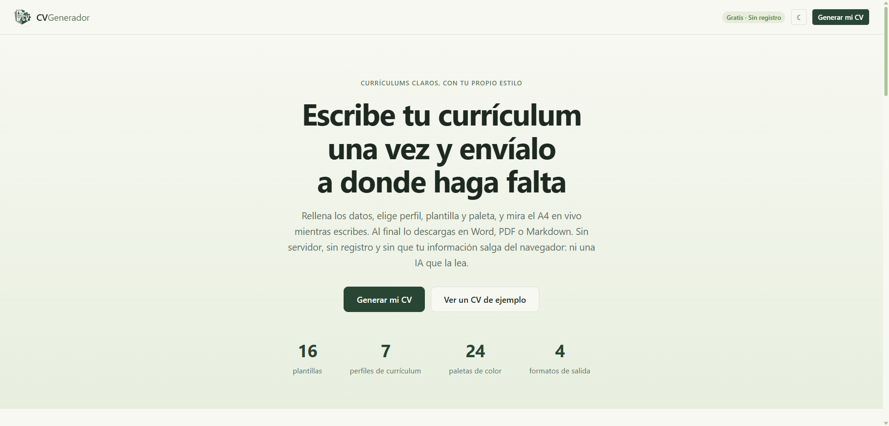
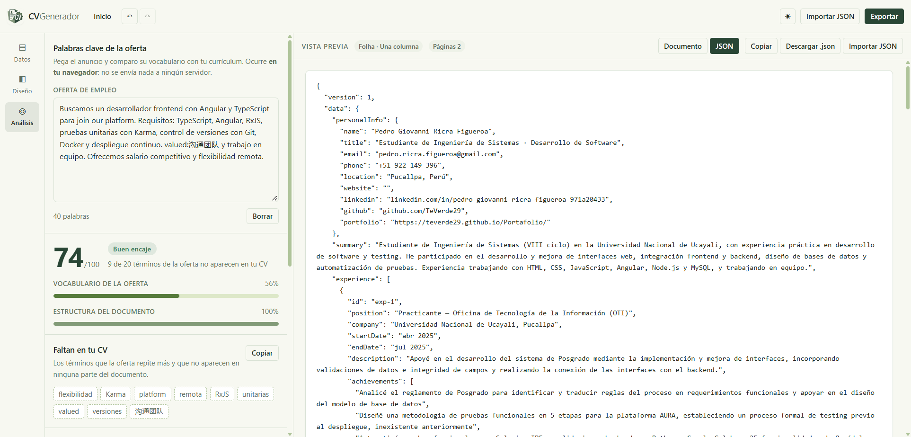
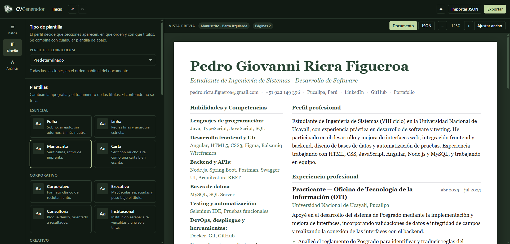

# CV Generador — editor de currículums que corre entero en tu navegador

> Escribe tu currículum una vez, elige perfil, plantilla y paleta, mira el A4 en vivo y descárgalo en Word, PDF o Markdown. Todo ocurre en tu navegador: sin servidor, sin registro y sin que tus datos salgan del equipo.


## Capturas

| Portada | Editor de datos con el CV de ejemplo |
|---|---|
|  |  |

| Panel de diseño | Análisis frente a una oferta |
|---|---|
|  |  |

| Exportación | Vista JSON |
|---|---|
|  |  |

Plantilla Manuscrito con barra lateral izquierda y tema oscuro. Con barra lateral, Competencias, Idiomas, Certificaciones e Intereses se colocan solos en la columna lateral y el documento se lee por ahí:



## Tabla de contenidos

- [Nombre y descripción del proyecto](#nombre-y-descripción-del-proyecto)
- [Stack tecnológico](#stack-tecnológico)
- [Arquitectura del proyecto](#arquitectura-del-proyecto)
- [Instalación y uso](#instalación-y-uso)
- [Flujo básico de uso](#flujo-básico-de-uso)
- [Requisitos del sistema](#requisitos-del-sistema)
- [Características principales](#características-principales)
- [Modelo de datos](#modelo-de-datos)
- [Analizador de palabras clave](#analizador-de-palabras-clave)
- [Exportadores](#exportadores)
- [Pruebas](#pruebas)
- [Notas de deploy](#notas-de-deploy)
- [Buenas prácticas de uso](#buenas-prácticas-de-uso)
- [Roadmap](#roadmap)
- [Licencia](#licencia)
- [Autor](#autor)

## Descripción

CV Generador es una aplicación de página única (SPA) en Angular 19.2 que permite crear currículums vitae enteramente en el navegador, sin backend, sin registro y sin que los datos salgan del equipo del usuario. No usa IA de ningún tipo.

El problema que resuelve es concreto: un currículum se escribe una vez y se envía a sitios que no se parecen en nada — un portal con un formulario que lee el texto, un correo que espera un PDF maquetado y una web técnica que pide un perfil técnico. La mayoría de generadores obligan a elegir: o dan un editor bonito que exporta una imagen ilegible para un filtro, o dan una plantilla rígida que no se puede adaptar al sector. Además suelen pedir cuenta y subir los datos a un servidor sin necesidad.

Este editor resuelve las dos cosas: perfil y plantilla son ejes independientes. El perfil decide qué secciones aparecen, en qué orden y con qué títulos; la plantilla decide cómo se ve. Se combinan como quieras. Cada export va al formato que le sirve a quien lo recibe: Word para los filtros que leen texto, PDF con el diseño exacto que ves, Markdown para portales y perfiles técnicos, y JSON para tus propias herramientas o para guardar una copia. Quien revisa el currículum no entra en la aplicación: recibe uno de esos archivos.

Las decisiones clave de diseño están en el código: el estado vive en un solo servicio con signals (`src/app/core/services/cv-store.service.ts`), el diseño de una plantilla está declarado dos veces a propósito — en el SCSS para la pantalla y en `src/app/core/models/template-look.ts` para Word, que no entiende CSS — y el documento del CV no usa los tokens de la aplicación, define los suyos (`--cv-*`) y se imprime siempre sobre blanco con la paleta que elija el usuario.

## Demo / Producción / Descarga

| Capa | URL |
|------|-----|
| Producción | https://cv-generador-ricra.vercel.app/ |
| Código | https://github.com/TeVerde29/CV-Generador |

## Características principales

- **Perfiles de currículum:** Predeterminado, Clásico, Ejecutivo, Técnico, Estudiante, Sin experiencia, Una página, MBA y Posgrado, Para Becas e Investigación. Cada uno decide qué secciones salen, en qué orden y con qué títulos (`src/app/core/models/profiles.ts`).
- **Dieciséis plantillas** en cuatro familias (Esencial, Corporativo, Creativo y Académico), con cuatro estructuras de página: una columna, barra izquierda, barra derecha y dos columnas (`src/app/core/models/catalog.ts`).
- **Veinticuatro paletas** más color propio (principal, secundario y acento a mano) (`src/app/core/models/catalog.ts`).
- **Secciones que se encienden y se apagan:** apagar una sección conserva sus datos y la saca del documento, del Word, del PDF y del Markdown (`src/app/core/services/cv-design.service.ts`).
- **Reordenar arrastrando:** cada elemento y cada sección tienen tirador; con el tirador enfocado, las flechas mueven una posición (`src/app/shared/sortable/sortable.directive.ts`).
- **Deshacer y rehacer de verdad:** `Ctrl+Z` y `Ctrl+Shift+Z`, con las pulsaciones agrupadas en una ventana de 700 ms para no retroceder carácter a carácter (`src/app/core/services/cv-history.service.ts`).
- **Autoguardado:** cada cambio se guarda en `cvgen.data` y `cvgen.design` sin botones ni avisos (`src/app/core/services/cv-persistence.service.ts`).
- **Foto opcional, apagada por defecto:** se recorta a cuadrado y se reencoda a 512 px JPEG en el navegador, y viaja dentro del `.docx` y del PDF (`src/app/features/editor/editor.component.ts`).
- **Analizador de la oferta:** nota de 0 a 100, términos que faltan ordenados por peso, botón para copiarlos y nueve comprobaciones estructurales (`src/app/core/models/ats.ts`).
- **Vista Documento / JSON:** el mismo currículum en el A4 real o en texto plano, con copiar, descargar e importar (`src/app/features/preview/preview.component.ts`).
- **Tema claro y oscuro** con detección de la preferencia del sistema, y vista de una sola columna en móvil con conmutador «Editar / Vista previa» (`src/app/app.component.ts`).
- **Cuatro formatos de salida:** Word (.docx), PDF (.pdf), Markdown (.md) y JSON (.json), seleccionables individualmente o en grupo (`src/app/core/services/exporter.service.ts`).

## Stack tecnológico

| Capa | Tecnología | Versión | Función |
|------|-----------|---------|---------|
| Framework | Angular | ^19.2.0 | SPA, componentes, signals, routing implícito |
| Lenguaje | TypeScript | ~5.7.2 | Tipado estático |
| Reactividad | RxJS | ~7.8.0 | Observables internos de Angular |
| Polyfill | zone.js | ~0.15.0 | Detección de cambios |
| Word (.docx) | docx | ^9.12.0 | Generación de documentos Word |
| Rasterizado | html2canvas | ^1.4.1 | Captura del lienzo A4 para el PDF |
| PDF | jspdf | ^4.2.1 | Generación de archivos PDF |
| Pruebas | Jasmine / Karma | 5.6.0 / 6.4.0 | Tests unitarios (36 pruebas) |
| Compresión | jszip | ^3.10.2 | Lectura de paquetes .docx en pruebas |
| Build | Angular CLI | ^19.2.0 | Compilación y servidor de desarrollo |

## Arquitectura

```
src/
├── app/
│   ├── app.component.*           # Shell: barra superior, rail de pestañas, panel y lienzo
│   ├── app.config.ts             # Bootstrap de la aplicación standalone
│   ├── core/
│   │   ├── models/
│   │   │   ├── cv-data.ts            # Contrato CVData y tipos de plantilla/layout/paleta
│   │   │   ├── catalog.ts            # 16 plantillas, 4 estructuras, 24 paletas y CV de ejemplo
│   │   │   ├── profiles.ts           # 7 perfiles de currículum (10 implementados)
│   │   │   ├── sections.ts           # 13 claves de sección, orden por defecto, documentOrder()
│   │   │   ├── template-look.ts      # Apariencia de cada plantilla como datos (lo que lee el .docx)
│   │   │   ├── json-payload.ts       # El JSON de ida y vuelta: se arma, se lee y se normaliza
│   │   │   ├── labels.ts             # Etiquetas de contacto y proyecto, toHref() y safeFileName()
│   │   │   └── ats.ts                # Analizador: tokenizado, extracción, 9 comprobaciones y nota
│   │   └── services/
│   │       ├── cv-store.service.ts       # Signals, autoguardado, CRUD, historial, JSON y perfiles
│   │       ├── cv-design.service.ts      # Configuración de diseño: plantilla, layout, paleta, orden y visibilidad
│   │       ├── cv-persistence.service.ts # Persistencia en localStorage (6 claves cvgen.*)
│   │       ├── cv-history.service.ts     # Historial de deshacer/rehacer (60 pasos, coalescencia 700 ms)
│   │       ├── exporter.service.ts       # Coordinador de exportación Markdown, .docx, PDF, JSON
│   │       ├── exporters/
│   │       │   ├── json-exporter.ts
│   │       │   ├── markdown-exporter.ts
│   │       │   ├── docx-exporter.ts
│   │       │   └── pdf-exporter.ts
│   │       ├── docx-look.ts              # Traduce template-look a medios puntos, twips y fuentes
│   │       ├── preview-registry.service.ts # Expone el A4 renderizado al exportador de PDF
│   │       └── toast.service.ts          # Notificaciones ok/err/info con auto-despedida
│   ├── features/
│   │   ├── landing/              # Portada: qué es, cómo funciona y el botón inicial
│   │   ├── editor/               # Panel de datos: 14 bloques desplegables, orden y visibilidad
│   │   │   └── cv-item/            # Cáscara reutilizable de un ítem de colección del editor
│   │   ├── design/               # Panel de diseño: perfil, plantilla, estructura, paleta
│   │   ├── preview/              # Vista previa A4, contador de páginas, y conmutador Documento / JSON
│   │   │   └── cv-document/        # El A4: plantillas y estructuras por variables CSS
│   │   ├── export/               # Popover de exportación con 4 formatos seleccionables
│   │   ├── import/               # Popover para traer un currículum desde un .json
│   │   ├── ats/                  # Panel de análisis frente a la oferta
│   │   ├── privacy/              # Página de política de privacidad
│   │   ├── about/                # Página Acerca de
│   │   └── contact/              # Página de contacto
│   └── shared/
│       ├── tag-input/            # Editor de listas de etiquetas (Enter añade, Retroceso quita)
│       └── sortable/             # Reordenación con puntero y teclado
├── public/
│   ├── logo-cv-generador.png     # Logo 512×512 transparente, también favicon
│   ├── sitemap.xml               # Sitemap para buscadores
│   ├── robots.txt                # Directrices para rastreadores
│   └── .well-known/
│       └── security.txt          # Contacto de seguridad (RFC 9116)
├── img/
│   ├── 00-portada.png
│   ├── 01-editor.png
│   ├── 02-diseno.png
│   ├── 03-analisis.png
│   ├── 04-exportar.png
│   ├── 05-json.png
│   └── 06-oscuro-barra-lateral.png
├── dist/                         # Build de producción (sitio estático)
├── angular.json                  # Build a dist/cv-generador; jspdf, html2canvas y canvg como CommonJS
├── karma.conf.js                 # Lanzador ChromeHeadlessCI (--headless=new)
├── tsconfig.json                 # Configuración TypeScript
├── tsconfig.app.json
├── tsconfig.spec.json
├── package.json                  # Scripts: start, build, watch, test
├── README.md
├── LICENSE
└── funcionalidades.md            # Documento de referencia del estado de todas las funcionalidades
```

Decisiones de arquitectura:

- **Un solo servicio con signals** (`cv-store.service.ts`) es el estado. El editor, el panel de diseño, el analizador, la vista previa y los exportadores leen de ahí, así que no hay copias que sincronizar.
- **Vista previa y exports comparten funciones.** `documentOrder()` y `orderedSections()` de `sections.ts` las usan el documento en pantalla y el exportador, así que el Word lista las secciones en el mismo orden que la pantalla.
- **El diseño de una plantilla está declarado dos veces a propósito**, en el SCSS (para la pantalla) y en `template-look.ts` (para Word, que no entiende CSS). Sin ese espejo, el `.docx` salía con la tipografía y el azul por defecto de Word.
- **El perfil no se guarda, se deriva.** Comparando el orden y la visibilidad reales de las secciones con cada perfil del catálogo: en cuanto ajustas el orden a mano, el desplegable dice «Personalizado» y nunca miente sobre lo que hay en el documento.
- **El documento del CV no usa los tokens de la aplicación.** Define los suyos (`--cv-*`) y se imprime siempre sobre blanco, con la paleta que elija el usuario: el tema de la aplicación no altera el currículum.

## Instalación y uso

Requisitos: Node.js 20 o superior (probado con Node 22 y 24) y npm 10 o superior.

```bash
git clone https://github.com/TeVerde29/CV-Generador.git
cd CV-Generador
npm install
npm start          # servidor de desarrollo en http://localhost:4200
```

Otros comandos:

```bash
npm run build      # compila a dist/cv-generador (sitio estático)
npm run watch      # compila en modo desarrollo y vigila cambios
npm test           # 36 pruebas unitarias: Karma + Jasmine en Chrome headless
```

`npm run build` no necesita servidor de aplicaciones: `dist/cv-generador` se puede publicar en GitHub Pages, Netlify o un bucket S3 tal cual.

> Si `npm test` se queda esperando navegador: Karma necesita Chrome. En un equipo donde solo está Edge, se le dice dónde está: `CHROME_BIN="C:\Program Files (x86)\Microsoft\Edge\Application\msedge.exe" npm test`.

### Flujo básico de uso

1. **Portada** → «Generar mi CV» abre el generador en blanco (o «Continuar donde lo dejaste» si había un currículum guardado en ese navegador).
2. **Escribe los datos** en el panel «Datos»: catorce bloques desplegables, cada uno con su contador. La barra superior lleva la cuenta.
3. **Elige el diseño** en «Diseño»: perfil, plantilla, estructura de página y paleta.
4. **Pega la oferta** en «Análisis» y revisa la nota: el vocabulario que falta aparece arriba del todo, con un botón para copiarlo.
5. **Exporta** con el botón azul: marca los formatos (Word, PDF, Markdown y JSON) y pulsa «Exportar N formatos».
6. Todo se guarda solo: al volver a `http://localhost:4200` está todo como lo dejaste.

Atajos: `Ctrl+Z` deshacer, `Ctrl+Shift+Z` o `Ctrl+Y` rehacer y `Ctrl+E` abre o cierra la exportación.

## Requisitos del sistema

| Componente | Requisito mínimo |
|------------|------------------|
| Node.js | 20 o superior (probado con 22 y 24) |
| npm | 10 o superior |
| Navegador | Chrome, Chromium o Edge (para `npm test`) |
| Memoria | No especificado (SPA ligera, ~211 kB transferido) |

## Modelo de datos

`CVData` es el único contrato, definido en `src/app/core/models/cv-data.ts`:

```ts
interface CVData {
  personalInfo: {
    name: string; title: string; email: string; phone: string; location: string;
    website: string; linkedin: string; github: string; portfolio: string;
    photo?: string;            // data URL JPEG de 512 px, solo si el usuario la añade
  };
  summary: string;             // perfil profesional, hasta 1000 caracteres
  experience: ExperienceItem[];      // puesto, empresa, fechas, descripción, logros[]
  education: EducationItem[];        // titulación, área, institución, fechas
  skills: SkillGroup[];              // { categoría, items[] }
  languages: LanguageItem[];         // idioma + nivel (5 valores)
  projects: ProjectItem[];           // nombre, descripción, tecnologías[], demoUrl, repoUrl
  certifications: CertificationItem[];// nombre, emisor, fecha, url
  publications: PublicationItem[];    // título, medio, fecha, url, descripción
  volunteerWork: VolunteerItem[];    // organización, rol, fechas, descripción
  awards: AwardItem[];               // título, emisor, fecha, descripción
  references: ReferenceItem[];       // nombre, título, correo, teléfono
  customSections: CustomSectionItem[]; // título, fechas, enlace, descripción, entradas[]
  interests: string[];
}
```

Todo lo que entra por `localStorage` pasa por `normalizeCVData()`: rellena campos ausentes, descarta tipos incorrectos y migra el `url` suelto de los proyectos a `demoUrl` / `repoUrl`. Una copia antigua o manipulada no rompe la aplicación.

Claves de almacenamiento, todas con prefijo `cvgen.`:

| Clave | Contenido |
|-------|-----------|
| `cvgen.data` | El CV completo (`CVData`), foto incluida |
| `cvgen.design` | Plantilla, estructura, paleta, colores propios, orden de secciones, secciones apagadas, forma de la foto y marca al pie |
| `cvgen.presets` | Combinaciones de diseño guardadas |
| `cvgen.palettes` | Paletas propias guardadas |
| `cvgen.offer` | La oferta pegada para el análisis |
| `cvgen.theme` | Tema claro u oscuro |

## Analizador de palabras clave

El panel «Análisis» compara la oferta con el CV en el navegador. La nota es una media ponderada:

```
nota = 60 % vocabulario de la oferta cubierto + 40 % estructura del documento
```

- **Vocabulario:** extrae hasta 40 términos (palabras y frases de dos o tres palabras), los pesa por apariciones y longitud, y cuenta cuántos aparecen ya en el CV. Ambas partes se normalizan igual (minúsculas y sin acentos), así que ni las tildes ni las mayúsculas producen un falso «falta».
- **Estructura:** nueve comprobaciones con peso propio.

| Comprobación | Peso |
|--------------|------|
| Datos de contacto completos (correo y teléfono) | 15 |
| Experiencia con fechas en todos los puestos | 15 |
| Perfil profesional de 200 caracteres o más | 12 |
| Al menos tres logros con cifras | 12 |
| Cinco competencias o más | 12 |
| Formación indicada | 10 |
| Ubicación indicada | 8 |
| Enlace profesional (LinkedIn, GitHub o portafolio) | 8 |
| Idiomas indicados | 8 |

Veredictos: `Muy encajado` desde 80, `Buen encaje` desde 65, `Mejorable` desde 45 y `Poco encajado` por debajo. Cada comprobación explica por qué importa, y los términos que faltan se ordenan por peso para que lo primero que leas sea lo que el filtro busca.

## Exportadores

| Formato | Cómo se genera | Qué trae y qué límite tiene |
|---------|---------------|------------------------------|
| Word (`.docx`) | `docx` 9 en el navegador (`exporter.service.ts` + `docx-look.ts`) | Documento editable con la tipografía, los colores de la paleta, las reglas de los títulos, el orden de secciones y los hipervínculos. La maquetación es lineal de una columna aunque elijas barra lateral: ningún ATS se pierde entre cuadros de texto |
| PDF (`.pdf`) | `html2canvas` + `jspdf`, cargados solo al pulsar «PDF» | Descarga inmediata, sin diálogo de impresión. El corte busca el principio de una sección antes de partir una línea y las páginas de continuación conservan el margen superior. Al ser una imagen el texto no se puede seleccionar, así que los enlaces se añaden como anotaciones sobre el texto que los muestra |
| Markdown (`.md`) | Texto plano, sin dependencias | Estructura limpia para portales de empleo y perfiles técnicos. No lleva la foto (un `.md` no tiene imágenes) |
| JSON (`.json`) | Texto plano, con los datos y el diseño | El viaje de ida y vuelta: se descarga, se vuelve a importar y se puede leer desde otro programa. Acepta también un JSON con solo los datos |

Los cuatro formatos se pueden marcar y descargar juntos, o uno a uno con «Solo este». La **marca al pie opcional** está desactivada por defecto y, si se activa, se aplica a todos.

## Pruebas

```bash
npm test
```

36 pruebas unitarias repartidas por capa:

1. **Analizador** (`src/app/core/models/ats.spec.ts`, 13 pruebas): tokenizado sin acentos, extracción de términos y frases, pesos, y la nota final. Lógica pura, sin DOM.
2. **Modelo de datos** (`src/app/core/services/cv-store.service.spec.ts`, 4 pruebas): normalización del CV y migración de enlaces de proyectos.
3. **Exportadores** (`src/app/core/services/exporter.service.spec.ts`, 19 pruebas): Markdown, geometría de `docxLook` y el `.docx` de verdad. Las pruebas de Word descomprimen el paquete con `jszip` y buscan en `word/document.xml` la tipografía, los colores de la paleta, el orden de las secciones, el orden de lectura con barra lateral y el centrado de títulos frente al cuerpo, que es donde se escapó el fallo más caro de esta parte.

`karma.conf.js` define el lanzador `ChromeHeadlessCI` con `--headless=new` y `--remote-debugging-port=0`, porque el lanzador estándar de Karma usa el flag `--headless` antiguo que las versiones recientes de Chrome ya no aceptan, y porque evita pelearse con otra sesión de DevTools por el puerto 9222.

## Notas de deploy

1. `npm run build` genera `dist/cv-generador`, un sitio estático que no necesita servidor de aplicaciones.
2. Los archivos estáticos (`sitemap.xml`, `robots.txt`, `.well-known/security.txt`, `llms.txt`) se copian automáticamente desde `public/` al build.
3. El build de producción pesa ~838 kB bruto, ~211 kB transferido.
4. Si se desplega en una subcarpeta, ajustar `<base href="/">` en `src/index.html`.
5. No se requiere backend: el sitio es 100 % estático y funciona en GitHub Pages, Netlify, S3 o cualquier servidor de archivos estáticos.

## Buenas prácticas de uso

- No almacenes datos sensibles que no quieras que queden en el `localStorage` de tu navegador: el CV vive ahí, sin servidor ni cifrado adicional.
- Descarga el JSON como copia de seguridad antes de borrar los datos de navegación.
- Usa el analizador de ofertas para ajustar el vocabulario de tu CV a cada puesto, pero recuerda que es aritmética sobre texto, no IA.
- Si usas barra lateral, las secciones Competencias, Idiomas, Certificaciones e Intereses se mueven a la columna lateral automáticamente.
- El PDF se genera rasterizando el A4 con html2canvas; el texto no es seleccionable pero los enlaces sí funcionan como anotaciones.

## Roadmap

- Editar el modo JSON directamente como el modo Documento (pendiente de implementar).
- 24 paletas de color variadas y profesionales, manteniendo Té verde.

## Licencia

Este proyecto se distribuye bajo la licencia **MIT**. Consulta el archivo `LICENSE` para más detalles.

---

**Pedro Giovanni Ricra Figueroa** — Ingeniería de Sistemas

[GitHub](https://github.com/TeVerde29) · [hikih020@gmail.com](mailto:hikih020@gmail.com)

---

Si este proyecto te resultó útil, considera darle una estrella en GitHub.
