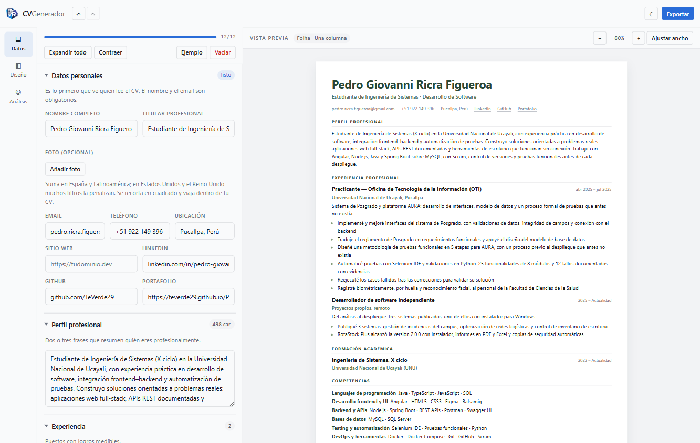
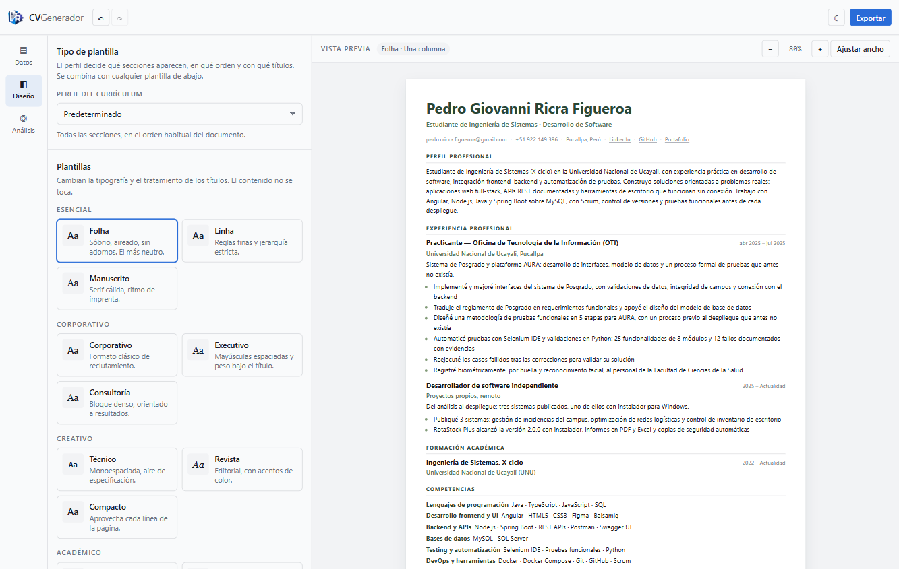
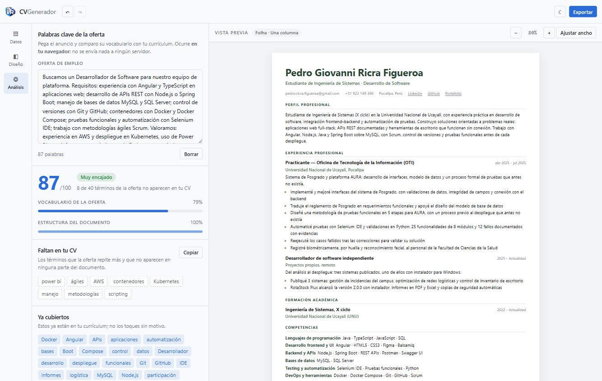
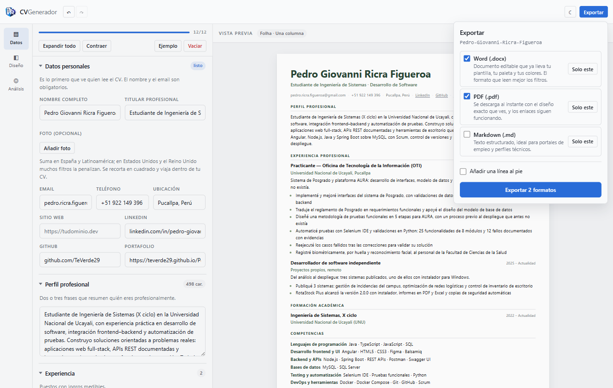
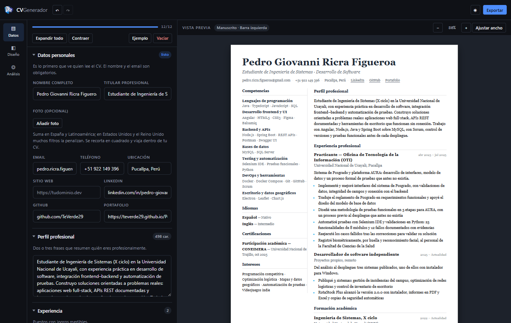

# CV Generador — editor de currículums que corre entero en tu navegador

> Escribes el CV una vez, eliges perfil y plantilla, lo ves en A4 en vivo y lo descargas en Word,
> PDF o Markdown. Sin backend, sin registro y sin que los datos salgan del navegador.


## Capturas

| Editor de datos con el CV de ejemplo | Panel de diseño: plantillas por familia |
|---|---|
|  |  |

| Análisis frente a una oferta | Exportación en Word, PDF y Markdown |
|---|---|
|  |  |

Plantilla Manuscrito con barra lateral izquierda y tema oscuro. Con barra lateral, Competencias,
Idiomas, Certificaciones e Intereses se colocan solos en la columna lateral y el documento se lee
por ahí:



Un candidato escribe su CV en el panel de datos; el perfil decide **qué secciones aparecen, en qué
orden y con qué títulos** y la plantilla decide **cómo se ve**. Al final descarga el archivo que le
pida cada portal: el Word para los filtros ATS, el PDF para enviarlo ya maquetado y el Markdown para
perfiles técnicos. Quien revisa el CV no entra en la aplicación: recibe uno de esos tres archivos.

## Tabla de contenidos

- [Descripción](#descripción)
- [Características principales](#características-principales)
- [Stack tecnológico](#stack-tecnológico)
- [Arquitectura](#arquitectura)
- [Instalación y uso](#instalación-y-uso)
- [Requisitos del sistema](#requisitos-del-sistema)
- [Modelo de datos](#modelo-de-datos)
- [Analizador de palabras clave](#analizador-de-palabras-clave)
- [Exportadores](#exportadores)
- [Pruebas](#pruebas)
- [Estado y siguientes pasos](#estado-y-siguientes-pasos)
- [Autor](#autor)

## Descripción

Un currículum se escribe una vez y se envía a sitios que no se parecen en nada: un portal con un
formulario que lee el texto, un correo a una persona que abre el adjunto y una web que pide un
perfil técnico. La mayoría de generadores obligan a elegir: o te dan un editor bonito que exporta una
imagen ilegible para un filtro, o te dan una plantilla rígida que no puedes adaptar a tu sector.
Además suelen pedir cuenta y subir tus datos a un servidor sin necesidad.

Este editor resuelve las dos cosas en el navegador. Se escribe el CV en un formulario de doce bloques
—datos personales, perfil, experiencia, formación, competencias, idiomas, proyectos,
certificaciones, publicaciones, voluntariado, reconocimientos e intereses—, se pega la oferta de
empleo para ver qué vocabulario falta y se descarga. No hay servidor: todo el estado vive en
`localStorage` y los archivos se generan en la propia pestaña.

Tres decisiones explican el resto:

- **Sin IA.** El análisis de la oferta es aritmética sobre texto: tokeniza, cuenta apariciones, pesa
  las frases y calcula una nota. Instantáneo, reproducible y sin depender de ningún servicio ni de
  ninguna clave, así que se recalcula mientras escribes.
- **Un solo marcado, doce plantillas.** `cv-document.component.scss` define cada plantilla como un
  juego de variables CSS bajo `.tpl-*`; `core/models/template-look.ts` es su espejo en datos y
  `core/services/docx-look.ts` traduce esos números a medios puntos, twips y fuentes de Word. Sin ese
  espejo, el `.docx` salía siempre con la tipografía y el azul por defecto de Word.
- **El perfil no se guarda, se deriva.** Comparando el orden y la visibilidad reales de las secciones
  con cada perfil del catálogo (`core/models/profiles.ts`): en cuanto ajustas el orden a mano, el
  desplegable dice «Personalizado» y nunca miente sobre lo que hay en el documento.

El trabajo previo está en [`ANALISIS-CV-GENERATOR.md`](ANALISIS-CV-GENERATOR.md): ingeniería inversa
del generador [destbreso/cv-generator](https://github.com/destbreso/cv-generator) (MIT) usada como
investigación de requisitos. El código de este repositorio es una implementación propia, con
arquitectura y funcionalidad distintas (perfiles, secciones que se encienden y se apagan, foto
opcional recortada, exportación a `.docx` y Markdown, deshacer/rehacer, reordenación arrastrando,
analizador de ofertas y marca al pie).

## Características principales

- **Perfil y plantilla como ejes independientes:** ocho perfiles (Predeterminado, Clásico,
  Ejecutivo, Técnico, Estudiante, Sin experiencia, Una página y Ricra) que cambian secciones, orden y
  títulos, y doce plantillas (Folha, Linha, Manuscrito, Corporativo, Executivo, Consultoría, Técnico,
  Revista, Compacto, Académico, Universidad y Tesis) agrupadas en cuatro familias: Esencial,
  Corporativo, Creativo y Académico.
- **Cuatro estructuras de página:** una columna, barra izquierda, barra derecha y dos columnas. Con
  barra lateral, Competencias, Idiomas, Certificaciones e Intereses se mueven solos a la columna
  lateral (ver `SIDE_SECTION_KEYS` en `core/models/sections.ts`).
- **Quince paletas más color propio:** Té verde, Matcha, Salvia, Tinta, Pizarra, Océano, Bosque,
  Oliva, Terracota, Vino, Mostaza, Índigo, Ciruela, Grafito y Monocromo, o principal, secundario y
  acento elegidos a mano.
- **Secciones que se encienden y se apagan:** apagar una sección conserva sus datos y la saca del
  documento, del Word, del PDF y del Markdown.
- **Reordenar arrastrando:** cada elemento y cada sección tienen tirador; el documento se reordena
  mientras arrastras y, con el tirador enfocado, las flechas mueven una posición.
- **Deshacer y rehacer de verdad:** `Ctrl+Z` y `Ctrl+Shift+Z` (o `Ctrl+Y`), con las pulsaciones
  agrupadas en una ventana de 700 ms para no retroceder carácter a carácter. Un arrastre entero se
  deshace de una vez.
- **Autoguardado:** cada cambio se guarda en `cvgen.data` y `cvgen.design` sin botones ni avisos.
- **Foto opcional, apagada por defecto:** se recorta a cuadrado y se reencoda a 512 px JPEG en el
  navegador (unos 60 kB), con marco cuadrado o redondo, y viaja dentro del `.docx` y del PDF. La
  interfaz avisa de que suma en España y Latinoamérica pero penaliza en Estados Unidos y el Reino
  Unido.
- **Enlaces con nombre:** el correo, el teléfono y la ciudad se leen como texto; LinkedIn, GitHub, la
  web y el portafolio se muestran con su nombre y se abren en otra pestaña. Cada proyecto admite
  «Demo» y «GitHub» opcionales.
- **Word con el diseño elegido:** tipografía, cuerpo, colores de la paleta, reglas de los títulos,
  mayúsculas y espaciado, más el orden de las secciones que se ve en pantalla.
- **PDF descargable con enlaces clicables:** se rasteriza el A4 y se corta en páginas; cada enlace
  vuelve como anotación invisible sobre su texto, así que sigue funcionando.
- **Analizador de ofertas sin salir del navegador:** nota de 0 a 100, términos que faltan ordenados
  por peso, botón para copiarlos y nueve comprobaciones estructurales.
- **Tema claro y oscuro** con detección de la preferencia del sistema, y vista de una sola columna en
  móvil con conmutador «Editar / Vista previa».

## Stack tecnológico

| Capa | Tecnología | Función |
|---|---|---|
| Framework | Angular 19.2 (standalone + signals) | Reactividad sin `NgModules`; el estado son signals |
| Lenguaje | TypeScript 5.7 | Contratos de `CVData` y del catálogo de diseños |
| Estilos | SCSS + variables CSS | Tokens en `src/styles/_tokens.scss`; las plantillas son conjuntos de variables |
| Word | [`docx`](https://www.npmjs.com/package/docx) 9.12 | OOXML real en el navegador, con hipervínculos, viñetas e imagen |
| PDF | [`html2canvas`](https://www.npmjs.com/package/html2canvas) 1.4 + [`jspdf`](https://www.npmjs.com/package/jspdf) 4.2 | Rasteriza el A4 y lo corta en páginas; se cargan solo al pulsar «PDF» |
| Pruebas | Karma 6.4 + Jasmine 5.6 | 36 pruebas unitarias; en el `.docx` se abren los paquetes de verdad con `jszip` 3.10 |
| Estado | `localStorage` | Autoguardado del CV, del diseño, de la oferta y del tema |
| Backend | Ninguno | El `ng build` produce un sitio estático |

Angular 19 se instaló con el CLI oficial. No hay Tailwind ni librería de componentes: el sistema de
diseño son tokens, con temas claro y oscuro. El currículum se imprime con pilas del sistema
(según la plantilla, serif, sans o monoespaciada), así que no se descarga ninguna fuente y el `.docx`
y el PDF se ven igual sin conexión.

## Arquitectura

```
karma.conf.js                    # lanzador ChromeHeadlessCI (--headless=new) para las pruebas
angular.json                     # build a dist/cv-generador; jspdf, html2canvas y canvg como CommonJS permitidos
src/
├── index.html
├── main.ts                      # bootstrapApplication(AppComponent)
├── styles.scss                  # reset + primitivas compartidas (.btn, .input, .badge, .toast…)
├── styles/_tokens.scss          # color, tipografía, radios y sombras; temas claro y oscuro
└── app/
    ├── app.component.*          # shell: barra superior, rail de pestañas, panel y lienzo; tema y atajos
    ├── core/
    │   ├── models/
    │   │   ├── cv-data.ts                # contrato CVData + normalizeCVData() tolerante
    │   │   ├── catalog.ts                # 12 plantillas, 4 estructuras, 15 paletas y SAMPLE_CV_DATA
    │   │   ├── profiles.ts               # 8 perfiles: secciones visibles, orden y títulos
    │   │   ├── sections.ts               # SectionKey, orden por defecto, lado y documentOrder()
    │   │   ├── template-look.ts          # el aspecto de cada plantilla como datos (lo que lee el .docx)
    │   │   ├── labels.ts                 # etiquetas de contacto y proyecto, toHref() y safeFileName()
    │   │   └── ats.ts                    # analizador: tokenizado, extracción, 9 comprobaciones y nota
    │   └── services/
    │       ├── cv-store.service.ts       # signals, autoguardado, CRUD, historial y perfiles
    │       ├── exporter.service.ts       # Markdown, .docx, PDF descargable y ayudantes de paginación
    │       ├── docx-look.ts              # traduce template-look a medios puntos, twips y fuentes de Word
    │       ├── preview-registry.service.ts # expone el A4 renderizado al exportador de PDF
    │       └── toast.service.ts
    ├── features/
    │   ├── editor/              # panel de datos: doce bloques, orden y visibilidad de secciones
    │   ├── design/              # panel de diseño: perfil, plantilla, estructura, paleta y colores propios
    │   ├── ats/                 # panel de análisis frente a la oferta
    │   ├── export/              # popover de exportación
    │   └── preview/
    │       ├── preview.component.*      # zoom (30–150 %), ajuste al ancho y registro del lienzo
    │       └── cv-document/             # el A4: plantillas y estructuras por variables CSS
    └── shared/
        ├── tag-input/           # editor de listas de etiquetas (Enter añade, Retroceso quita)
        └── sortable/            # reordenación con puntero y teclado
```

- **El estado es un solo servicio con signals** (`cv-store.service.ts`): el editor, el panel de
  diseño, el analizador, la vista previa y los exportadores leen de ahí, así que no hay copias que
  sincronizar. El historial guarda instantáneas del estado completo (`past` / `future`).
- **El lienzo renderizado se registra** en `preview-registry.service.ts`. El PDF lo clona fuera de la
  pantalla a escala 1:1 para medir secciones y enlaces, en lugar de volver a maquetar el documento.
- **Vista previa y exportadores comparten funciones.** `documentOrder()` y `orderedSections()` de
  `sections.ts` las usan el `cv-document` y el exportador, así que el Word lista las secciones en el
  mismo orden que la pantalla.
- **El diseño de una plantilla está declarado dos veces a propósito**, en el SCSS (para la pantalla)
  y en `template-look.ts` (para Word): Word no entiende CSS y necesita números.
- **Contenido y diseño se guardan por separado** (`cvgen.data` y `cvgen.design`), de modo que puedes
  cambiar de plantilla sin tocar un solo dato.

## Instalación y uso

Requisitos: **Node 20 o superior** (probado con Node 22.20.0 y npm 10.9.3).

```bash
git clone https://github.com/TeVerde29/CV-Generador.git
cd CV-Generador
npm install
npm start          # servidor de desarrollo en http://localhost:4200
```

Otros comandos:

```bash
npm run build      # compila a dist/cv-generador (sitio estático)
npm run watch      # compila en modo desarrollo y vigila cambios
npm test           # 36 pruebas unitarias: Karma + Jasmine en Chrome headless
```

`npm run build` no necesita servidor de aplicaciones: `dist/cv-generador` se puede publicar en GitHub
Pages, Netlify o un bucket S3 tal cual.

### Flujo básico de uso

1. **Escribe los datos** en el panel «Datos»: los doce bloques se despliegan por separado y cada uno
   muestra cuántos elementos tiene. La barra superior lleva la cuenta (`12/12`).
2. **Ajusta el orden y apaga lo que no quieras** desde «Orden de las secciones», dentro del propio
   editor. Apagar una sección no borra sus datos.
3. **Elige el perfil** en «Diseño → Perfil del currículum» (qué secciones aparecen y en qué orden) y
   **la plantilla** en la rejilla (cómo se ve). Debajo, la estructura de página y la paleta.
4. **Añade la foto si la necesitas**: «Añadir foto» recorta y encoge la imagen en el navegador.
5. **Pega la oferta** en «Análisis» y revisa la nota: el vocabulario que falta aparece arriba del
   todo, con un botón para copiarlo.
6. **Exporta** con el botón azul: marca los formatos (Word, PDF y Markdown) y pulsa «Exportar N
   formatos», o usa «Solo este» para bajar uno. Los nombres de archivo salen del nombre del CV.
7. El trabajo se guarda solo: al volver a `http://localhost:4200` está todo como lo dejaste.

Atajos: `Ctrl+Z` deshacer, `Ctrl+Shift+Z` o `Ctrl+Y` rehacer y `Ctrl+E` abre o cierra la exportación.

## Requisitos del sistema

| Componente | Requisito mínimo |
|---|---|
| Node.js | 20 o superior (probado con 22.20.0) |
| npm | 10 (incluido con Node 22) |
| Navegador | Chrome, Edge o Firefox actuales; el PDF necesita Canvas y Blob |
| Espacio en disco | ~500 MB con `node_modules`; `dist/cv-generador` ronda 2 MB |
| Almacenamiento | `localStorage` del navegador (unos 5 MB), compartido por CV, diseño y oferta |
| Pantalla | Escritorio para el editor de tres columnas; en móvil hay conmutador «Editar / Vista previa» |

## Modelo de datos

`CVData` es el único contrato, definido en `core/models/cv-data.ts`:

```ts
interface CVData {
  personalInfo: {
    name: string; title: string; email: string; phone: string; location: string;
    website: string; linkedin: string; github: string; portfolio: string;
    photo?: string;            // data URL JPEG de 512 px, solo si el usuario la añade
  };
  summary: string;
  experience: ExperienceItem[];      // position, company, location, startDate, endDate,
                                     // description, achievements[]
  education: EducationItem[];        // degree, field, institution, startDate, endDate, description
  skills: SkillGroup[];              // { category, items[] }
  languages: LanguageItem[];         // { name, level }
  projects: ProjectItem[];           // name, role, description, technologies[], demoUrl?, repoUrl?
  certifications: CertificationItem[];
  publications: PublicationItem[];
  volunteerWork: VolunteerItem[];
  awards: AwardItem[];
  interests: string[];
}
```

Todo lo que entra por `localStorage` pasa por `normalizeCVData()`: rellena campos ausentes, descarta
tipos incorrectos y migra el `url` único de los proyectos a `demoUrl` / `repoUrl`. Una copia antigua
o manipulada no rompe la aplicación.

Claves de almacenamiento, todas con prefijo `cvgen.`:

| Clave | Contenido |
|---|---|
| `cvgen.data` | El CV completo (`CVData`), foto incluida |
| `cvgen.design` | Plantilla, estructura, paleta, colores propios, orden de secciones, secciones apagadas, forma de la foto y marca al pie |
| `cvgen.offer` | La oferta pegada para el análisis |
| `cvgen.theme` | Tema claro u oscuro |

## Analizador de palabras clave

El panel «Análisis» compara la oferta con el CV en el navegador. La nota es una media ponderada:

```
nota = 60 % vocabulario de la oferta cubierto + 40 % estructura del documento
```

- **Vocabulario:** extrae hasta 40 términos (palabras y frases de dos o tres palabras), los pesa por
  apariciones y longitud, y cuenta cuántos aparecen ya en el CV. Ambas partes se normalizan igual
  (minúsculas y sin acentos), así que ni las tildes ni las mayúsculas producen un falso «falta».
- **Estructura:** nueve comprobaciones con peso propio.

| Comprobación | Peso |
|---|---|
| Datos de contacto completos (correo y teléfono) | 15 |
| Experiencia con fechas en todos los puestos | 15 |
| Perfil profesional de 200 caracteres o más | 12 |
| Al menos tres logros con cifras | 12 |
| Cinco competencias o más | 12 |
| Formación indicada | 10 |
| Ubicación indicada | 8 |
| Enlace profesional (LinkedIn, GitHub o portafolio) | 8 |
| Idiomas indicados | 8 |

Veredictos: `Muy encajado` desde 80, `Buen encaje` desde 65, `Mejorable` desde 45 y `Poco encajado`
por debajo. Cada comprobación explica por qué importa, y los términos que faltan se ordenan por peso
para que lo primero que leas sea lo que el filtro busca.

## Exportadores

| Formato | Cómo se genera | Qué trae y qué límite tiene |
|---|---|---|
| Word (`.docx`) | `docx` 9 en el navegador (`exporter.service.ts` + `docx-look.ts`) | Documento editable con la tipografía, los colores de la paleta, las reglas de los títulos, el orden de secciones y los hipervínculos. La maquetación es lineal de una columna aunque elijas barra lateral: ningún ATS se pierde entre cuadros de texto |
| PDF (`.pdf`) | `html2canvas` + `jspdf`, cargados solo al pulsar «PDF» | Descarga inmediata, sin diálogo de impresión. El corte busca el principio de una sección antes de partir una línea y las páginas de continuación conservan el margen superior. Al ser una imagen el texto no se puede seleccionar, así que los enlaces se añaden como anotaciones sobre el texto que los muestra |
| Markdown (`.md`) | Texto plano, sin dependencias | Estructura limpia para portales de empleo y perfiles técnicos. No lleva la foto (un `.md` no tiene imágenes) |

Los tres formatos se pueden marcar y descargar juntos, o uno a uno con «Solo este». La **marca al pie
opcional** está desactivada por defecto y, si se activa, se aplica a los tres.

## Pruebas

```bash
npm test
```

36 pruebas unitarias repartidas por capa:

1. **Analizador** (`core/models/ats.spec.ts`, 13 pruebas): tokenizado sin acentos, extracción de
   términos y frases, pesos, y la nota final. Lógica pura, sin DOM.
2. **Modelo de datos** (`core/services/cv-store.service.spec.ts`, 4 pruebas): normalización del CV y
   migración de enlaces de proyectos.
3. **Exportadores** (`core/services/exporter.service.spec.ts`, 19 pruebas): Markdown, geometría de
   `docxLook` y el `.docx` de verdad. Las pruebas de Word descomprimen el paquete con `jszip` y
   buscan en `word/document.xml` la tipografía, los colores de la paleta, el orden de las secciones,
   el orden de lectura con barra lateral y el centrado de títulos frente al cuerpo, que es donde se
   escapó el fallo más caro de esta parte.

`karma.conf.js` define el lanzador `ChromeHeadlessCI` con `--headless=new` y
`--remote-debugging-port=0`, porque el lanzador estándar de Karma usa el flag `--headless` antiguo
que las versiones recientes de Chrome ya no aceptan, y porque evita pelearse con otra sesión de
DevTools por el puerto 9222.

## Estado y siguientes pasos

Funciona de punta a punta y está verificado en navegador: los ocho perfiles, las doce plantillas, las
cuatro estructuras, las quince paletas, el autoguardado, deshacer y rehacer, la reordenación
arrastrando, las secciones que se encienden y se apagan, la foto opcional, el analizador y la
exportación. El `.docx` se comprueba descomprimiendo el archivo (tipografía, colores, orden y
centrado) y el PDF se comprueba sobre el fichero descargado (páginas, cortes y anotaciones de enlace
sobre su texto).

Pendiente, por orden de valor:

- [ ] Que Markdown respete también el orden de secciones del perfil.
- [ ] Varios CV por perfil, con duplicar y archivar.
- [ ] Generador de carta de presentación a partir de la misma oferta.
- [ ] Pruebas de extremo a extremo (las unitarias ya cubren analizador y exportadores).
- [ ] Convertirlo en PWA instalable con trabajo sin conexión.

---

**Pedro Giovanni Ricra Figueroa** — Ingeniería de Sistemas

[GitHub](https://github.com/TeVerde29) · [hikih020@gmail.com](mailto:hikih020@gmail.com)

---

Si este proyecto te resultó útil, considera darle una estrella en GitHub.
