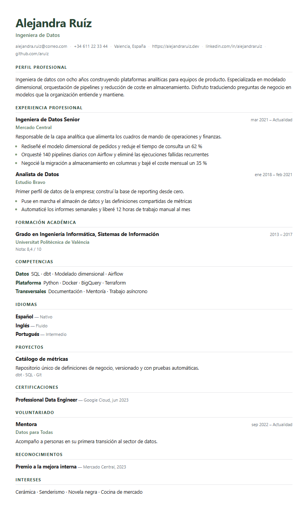

# CV Generador

Editor de currículums **que funciona entero en tu navegador**. Escribes tus datos, eliges una
plantilla, ves el A4 en vivo y descargas el resultado en **Word, PDF y Markdown**. No hay backend:
ni tus datos ni tu clave de API salen del navegador.




Interfaz con el sistema de diseño propio **Tea Green**: fondo crema, verdes de té y matcha, y
tipografía editorial (Space Grotesk + Inter).

---

## Qué tiene

### Diseño

- **12 plantillas** que cambian tipografía, jerarquía y tratamiento de títulos sin tocar el
  contenido: Folha, Linha, Manuscrito, Corporativo, Executivo, Consultoría, Técnico, Revista,
  Compacto, Académico, Universidad y Tesis.
- **4 estructuras de página**: una columna, barra lateral izquierda, barra lateral derecha y dos
  columnas. Con barra lateral, Competencias, Idiomas, Certificaciones e Intereses se colocan solos
  en la columna lateral.
- **15 paletas** listas más paleta personalizada (principal, secundario y acento), entre ellas la
  paleta de marca: Té verde, Matcha y Salvia.
- **Biblioteca propia**: guarda paletas y combinaciones completas (plantilla + estructura + paleta +
  orden de secciones) y reutilízalas.
- **Tema claro y oscuro** con detección de la preferencia del sistema.


Las doce plantillas comparten el mismo marcado y se diferencian solo por variables CSS. Eso hace que
la vista previa y el PDF impreso sean **exactamente el mismo documento**.

### Edición

- Editor estructurado de once bloques: datos personales, perfil, experiencia, formación,
  competencias, idiomas, proyectos, certificaciones, publicaciones, voluntariado, reconocimientos e
  intereses.
- Listas de etiquetas para logros, competencias y tecnologías (Enter para añadir, Retroceso para
  quitar).
- **Orden de secciones configurable** desde el propio editor.
- **Deshacer y rehacer de verdad** (`Ctrl+Z` / `Ctrl+Shift+Z`), con las pulsaciones agrupadas para no
  retroceder carácter a carácter.
- **Autoguardado** en `localStorage` con indicador *Guardando… / Guardado*.
- **Copia de seguridad en JSON**: exportar e importar el CV completo.

### Optimización con IA

- Usa **tu propia clave de Gemini** contra el endpoint compatible con OpenAI
  (`https://generativelanguage.googleapis.com/v1beta/openai`). La petición va del navegador a Google,
  sin intermediarios.
- La clave **vive solo en memoria**: no se escribe en `localStorage`, no se persiste y desaparece al
  cerrar la pestaña. Puedes olvidarla con un botón.
- Lista de modelos reales de tu clave (`Actualizar`), con campo libre por si prefieres escribir el
  identificador.
- **Probar conexión** antes de gastar una generación.
- Le pegas la **oferta de trabajo** y reescribe tu CV para alinearlo con ese lenguaje.
- La IA **solo reescribe lo que ya está**: tiene prohibido inventar empresas, fechas, titulaciones o
  métricas. La respuesta se valida campo a campo contra tu CV original.
- La propuesta **no se aplica sola**: aparece en la vista previa con un aviso y botones de
  *Aplicar* o *Descartar*.
- **Historial** de generaciones guardado en el navegador, con restauración en un clic.

### Exportación

- **Word (`.docx`)** generado en el navegador con `docx`: documento real, editable, con estilos,
  viñetas e hipervínculos, y pensado para que los filtros ATS lo lean en orden.
- **PDF** abriendo una ventana de impresión que clona el lienzo ya renderizado: es el diseño exacto
  de la vista previa, en vectorial. Eliges «Guardar como PDF» en el diálogo.
- **Markdown (`.md`)**: estructura limpia en texto plano, útil para portales de empleo y perfiles
  técnicos.
- Los tres formatos se pueden **seleccionar** y exportar juntos, o uno a uno con *Solo este*.
- **Marca al pie opcional**, desactivada por defecto. Si la activas, eliges el texto y se aplica a
  los tres formatos.

---

## Puesta en marcha

Requisitos: **Node 20 o superior** (probado con Node 22).

```bash
npm install
npm start          # servidor de desarrollo en http://localhost:4200
```

Otros comandos:

```bash
npm run build      # compila a dist/cv-generador (sitio estático)
npm test           # Karma + Jasmine (configurado; todavía sin especificaciones)
```

`npm run build` produce un sitio **completamente estático**: se puede publicar en cualquier CDN,
en GitHub Pages, en Netlify o en un bucket S3 sin necesidad de servidor de aplicaciones.

---

## Stack

| Pieza | Elección | Por qué |
|---|---|---|
| Framework | Angular 19 (standalone + signals) | Reactividad sin `zone.js` innecesario, sin `NgModules` |
| Estilos | SCSS + variables CSS | Control total del acabado editorial; las plantillas son solo variables |
| Diseño | Sistema propio **Tea Green** | Colores, tipografía, radios y sombras definidos como tokens |
| Tipografía | Space Grotesk + Inter, **autoalojadas** | Voz editorial sin depender de un CDN ni perder el uso sin conexión |
| Word | [`docx`](https://www.npmjs.com/package/docx) 9 | Genera OOXML real en el navegador |
| PDF | Diálogo de impresión del navegador | Vectorial, sin dependencias y con fidelidad total al diseño |
| IA | Gemini, endpoint OpenAI-compatible | CORS abierto: el navegador puede llamar directo a Google |
| Backend | Ninguno | Los datos y la clave nunca salen del navegador |

Angular 19 se instaló con el CLI oficial. Sin Tailwind ni librerías de componentes: el sistema de
diseño son tokens en `src/styles/_tokens.scss`, y las dos tipografías se sirven desde
`public/fonts/` con `@font-face` en `src/styles/_fonts.scss`. Space Grotesk titula (marca y
encabezados de panel), Inter compone el texto y la interfaz.

El currículum, en cambio, **no** usa la tipografía de la aplicación: se imprime con pilas del
sistema para garantizar que el `.docx` y el PDF se vean igual en cualquier equipo.

---

## Estructura

```
src/
├── styles/
│   ├── _tokens.scss              # sistema Tea Green: color, tipografía, radios, sombras, temas
│   ├── _fonts.scss               # @font-face de Space Grotesk e Inter (autoalojadas)
│   └── …
├── styles.scss                   # reset + primitivas compartidas (.btn, .input, .toast…)
└── app/
    ├── app.component.*           # shell: barra superior, rail, panel, lienzo, atajos
    ├── core/
    │   ├── models/
    │   │   ├── cv-data.ts        # contrato CVData + normalizador tolerante
    │   │   ├── catalog.ts        # 12 plantillas, 4 estructuras, 15 paletas, datos de ejemplo
    │   │   ├── sections.ts       # claves, orden por defecto y etiquetas de sección
    │   │   └── labels.ts         # títulos de sección, niveles de idioma, nombres de archivo
    │   └── services/
    │       ├── cv-store.service.ts        # estado con signals, persistencia, CRUD, undo/redo
    │       ├── gemini.service.ts          # cliente de Gemini, clave en memoria, prompt y parser
    │       ├── exporter.service.ts        # Markdown, .docx y ventana de impresión (PDF)
    │       ├── preview-registry.service.ts# expone el lienzo renderizado al exportador
    │       └── toast.service.ts
    ├── features/
    │   ├── editor/               # panel de datos
    │   ├── design/               # panel de diseño
    │   ├── ai/                   # panel de IA
    │   ├── export/               # panel de exportación (popover)
    │   └── preview/
    │       ├── preview.component.*        # zoom, ajuste de ancho, aviso de propuesta
    │       └── cv-document/               # el A4: plantillas × estructuras × paletas
    └── shared/tag-input/         # editor de listas de etiquetas
```

### Modelo de datos

`CVData` es el único contrato, definido en `core/models/cv-data.ts`. Todo lo que entra por
`localStorage` o por un JSON importado pasa por `normalizeCVData()`, que rellena campos ausentes y
descarta tipos incorrectos: así una copia antigua o manipulada nunca rompe la aplicación.

Claves de almacenamiento (todas con prefijo `cvgen.`):

| Clave | Contenido |
|---|---|
| `cvgen.data` | El CV (`CVData`) |
| `cvgen.design` | Plantilla, estructura, paleta, colores personalizados, orden de secciones y marca al pie |
| `cvgen.palettes` | Paletas guardadas |
| `cvgen.presets` | Combinaciones guardadas |
| `cvgen.history` | Historial de generaciones (original y optimizado) |
| `cvgen.theme` | Tema claro u oscuro |

**La clave de API no está en esta tabla a propósito**: nunca se persiste.

---

## Decisiones que conviene conocer

- **Sin backend.** Gemini expone cabeceras CORS en su endpoint compatible con OpenAI, así que el
  navegador puede llamarlo directamente. Esto elimina el servidor, el coste, y sobre todo el
  problema de custodiar la clave de otro.
- **El PDF no usa una librería.** Se clona el lienzo ya renderizado junto con las hojas de estilo
  aplicadas y se imprime. Una librería de PDF obligaría a mantener un segundo motor de maquetación y
  el resultado nunca sería idéntico a lo que el usuario ve.
- **Las plantillas son variables, no plantillas de HTML.** Un solo árbol de marcado, doce juegos de
  tokens. Añadir una plantilla nueva son unas pocas líneas de CSS.
- **La IA propone, no escribe.** El resultado se revisa antes de aplicarse y el parser valida el JSON
  contra el CV original para que no pueda colarse contenido inventado.

---

## Estado y siguientes pasos

Funciona de punta a punta y está verificado en navegador: las doce plantillas, las cuatro
estructuras, el autoguardado, deshacer/rehacer, la exportación a Word (comprobada descomprimiendo el
`.docx`) y la ventana de impresión.

Pendiente, por orden de valor:

- [ ] Reordenar arrastrando en lugar de con flechas (secciones y elementos de cada lista).
- [ ] Varios CV por perfil, con duplicar y archivar.
- [ ] Generador de carta de presentación a partir de la misma oferta.
- [ ] Analizador de palabras clave: puntuar el CV contra una oferta y señalar lo que falta.
- [ ] Pruebas unitarias y de extremo a extremo.
- [ ] Convertirlo en PWA instalable con trabajo sin conexión.

---

## Sobre este proyecto

Nació de un análisis funcional exhaustivo de un generador de CV libre con licencia MIT
([destbreso/cv-generator](https://github.com/destbreso/cv-generator)), documentado en
[`ANALISIS-CV-GENERATOR.md`](ANALISIS-CV-GENERATOR.md). Ese trabajo sirvió como investigación de
requisitos; **este código es una implementación propia**, escrita desde cero, con decisiones de
arquitectura distintas y funcionalidad que el original no tiene: exportación a `.docx` y Markdown,
deshacer y rehacer, orden de secciones editable, marca de agua opcional, IA con revisión previa e
historial restaurable.

---

Hecho por **R I C R A** · <hikih020@gmail.com>
