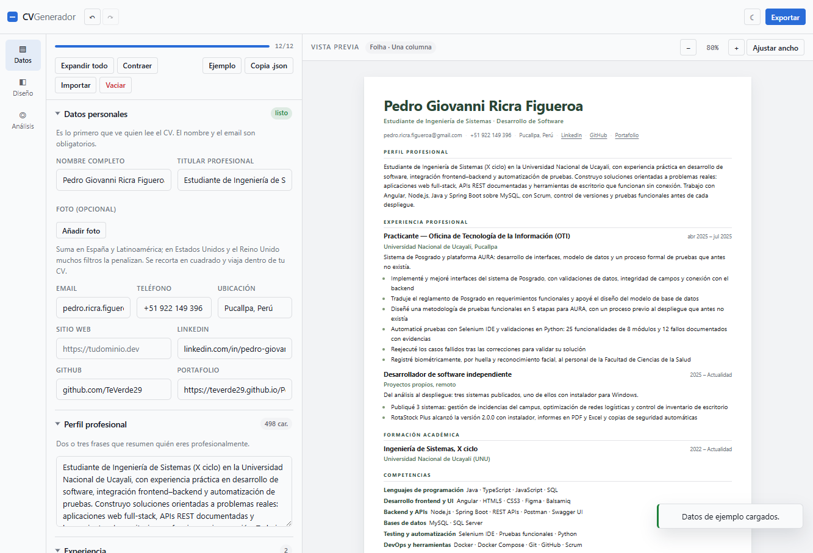
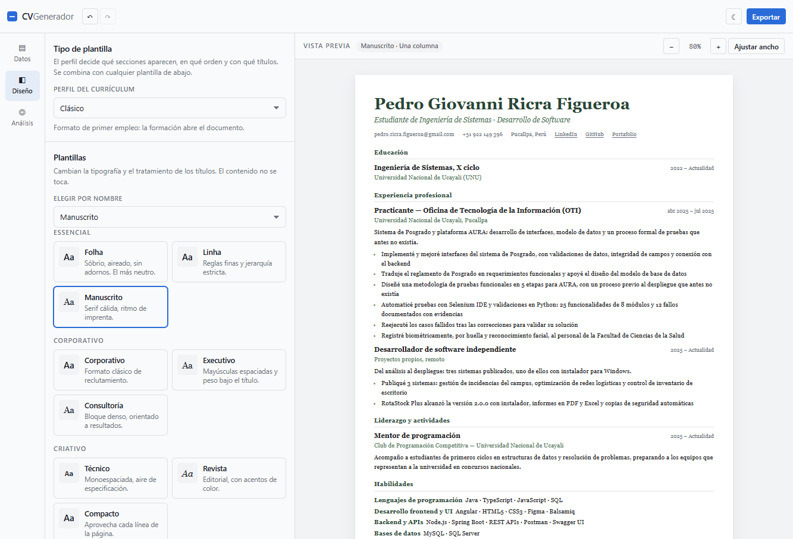
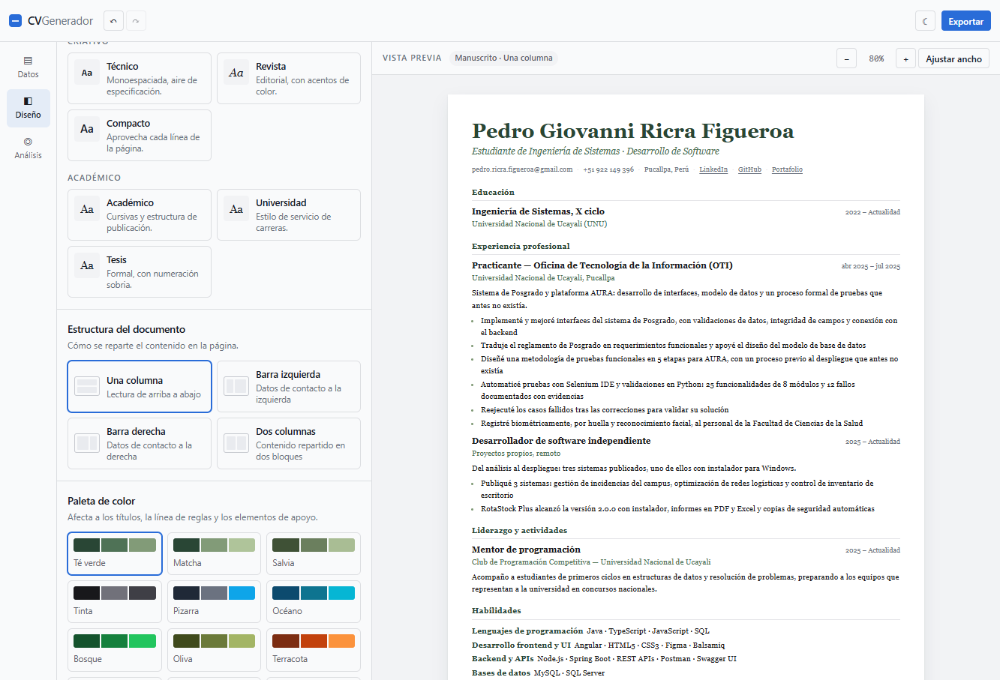
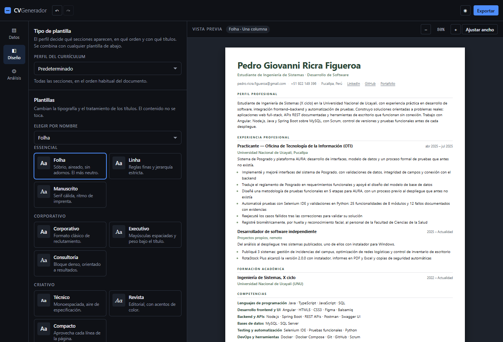
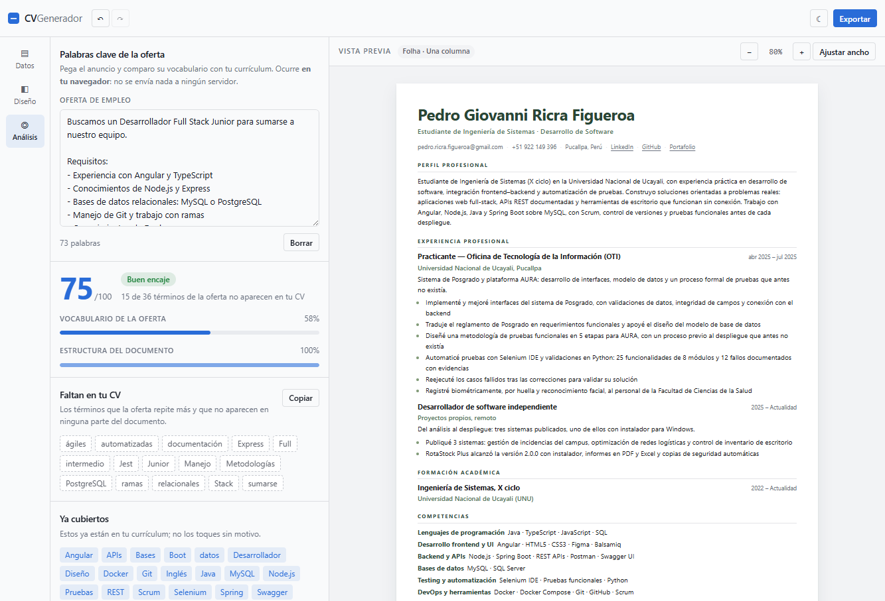

# CV Generador

Editor de currículums **que funciona entero en tu navegador**. Escribes tus datos, eliges un perfil y
una plantilla, ves el A4 en vivo y descargas el resultado en **Word, PDF y Markdown**. No hay backend:
tus datos nunca salen del navegador.











La interfaz es **blanca con azul profesional**: superficies limpias, bordes grises y un azul
corporativo (`#296cd8`) para acciones, foco y selección. No descarga ninguna fuente: usa las pilas
del sistema, así que se ve igual sin conexión y no filtra visitas a un CDN.

---

## Qué tiene

### Perfil y plantilla: dos ejes independientes

Un currículum se decide en dos pasos que no se pisan entre sí.

**El perfil** («Tipo de plantilla») decide **qué secciones aparecen, en qué orden y con qué
títulos**. No cambia el aspecto. Hay ocho, sacados de arquetipos reales:

| Perfil | Qué hace |
|---|---|
| Predeterminado | Todas las secciones, en el orden habitual |
| Clásico | Abre con la formación; cierra con habilidades e intereses |
| Ejecutivo | Experiencia y áreas de especialidad al frente |
| Técnico | Competencias técnicas, proyectos y certificaciones con peso |
| Estudiante | Proyectos académicos y actividades antes que la experiencia |
| Sin experiencia | Formación, proyectos, voluntariado y cursos |
| Una página | Solo lo esencial, para que quepa en una cara |
| Ricra | Resumen, habilidades por familias, experiencia y proyectos |

**La plantilla** decide el aspecto: tipografía, jerarquía y tratamiento de títulos. Hay doce, sin
tocar el contenido: Folha, Linha, Manuscrito, Corporativo, Executivo, Consultoría, Técnico, Revista,
Compacto, Académico, Universidad y Tesis. Se eligen de la rejilla por familias o del combo por
nombre.

Las doce comparten el mismo marcado y se diferencian solo por variables CSS. Eso hace que la vista
previa y el PDF impreso sean **exactamente el mismo documento**, y que añadir una plantilla nueva
sean unas pocas líneas de CSS.

Además:

- **4 estructuras de página**: una columna, barra lateral izquierda, barra lateral derecha y dos
  columnas. Con barra lateral, Competencias, Idiomas, Certificaciones e Intereses se colocan solos
  en la columna lateral.
- **15 paletas** listas más paleta personalizada (principal, secundario y acento), entre ellas Té
  verde, Matcha y Salvia.
- **Secciones que se encienden y se apagan** desde «Orden de las secciones». Apagar una sección
  conserva sus datos pero la saca del documento, del Word, del PDF y del Markdown.
- **Biblioteca propia**: guarda paletas y combinaciones completas (plantilla + estructura + paleta +
  orden de secciones) y reutilízalas.
- **Tema claro y oscuro** con detección de la preferencia del sistema.

### Foto (opcional)

- Está **apagada por defecto**: un CV sin foto es lo más seguro, y solo se añade si tú quieres.
- Se **recorta a cuadrado y se reencoda a 512 px en el propio navegador** (unos 60 kB), no se sube a
  ningún sitio y viaja dentro del CV.
- Marco **cuadrado o redondo**.
- La interfaz avisa de lo que importa: suma en España y Latinoamérica, pero en Estados Unidos y el
  Reino Unido muchos filtros la penalizan.
- Aparece también en el `.docx` (imagen flotante a la derecha del encabezado, sin romper el orden de
  lectura para un ATS) y en el PDF. En Markdown se omite, porque un `.md` no lleva imágenes.

### Edición

- Editor estructurado de doce bloques: datos personales, perfil, experiencia, formación,
  competencias, idiomas, proyectos, certificaciones, publicaciones, voluntariado, reconocimientos e
  intereses.
- Listas de etiquetas para logros, competencias y tecnologías (Enter para añadir, Retroceso para
  quitar).
- **Reordenar arrastrando**: cada elemento y cada sección tienen un tirador; el documento se
  reordena mientras arrastras. Con el tirador enfocado, las flechas ↑ y ↓ mueven una posición.
- **Orden y visibilidad de las secciones** desde el propio editor.
- **Deshacer y rehacer de verdad** (`Ctrl+Z` / `Ctrl+Shift+Z`), con las pulsaciones agrupadas para no
  retroceder carácter a carácter. Un arrastre entero se deshace de una vez, y cambiar el orden o
  apagar una sección entra en el historial como cualquier otra edición.
- **Autoguardado** en `localStorage`: cada cambio se guarda solo, sin botones ni avisos.
- **Copia de seguridad en JSON**: exportar e importar el CV completo.
- **Enlaces con nombre**: el correo, el teléfono y la ciudad se leen como texto, pero LinkedIn,
  GitHub, la web y el portafolio se muestran con su nombre (no con la URL) y se abren en una pestaña
  nueva. Cada proyecto admite **dos enlaces opcionales, «Demo» y «GitHub»**, y en el Word salen como
  hipervínculos de verdad.

### Análisis frente a la oferta

- Pega el anuncio y obtienes una **nota de 0 a 100** con dos componentes visibles: cuánto del
  vocabulario de la oferta cubre tu CV (60 %) y cuánto cumple la revisión estructural (40 %).
- Separa los **términos que faltan** de los que ya cubres, y los ordena por peso. Los que la oferta
  repite aparecen primero, porque son los que un filtro busca.
- Un botón **copia las palabras clave que faltan** para pegarlas donde las necesites.
- **Nueve comprobaciones** sobre el documento (contacto, ubicación, enlace, perfil, fechas, logros con
  cifras, competencias, formación e idiomas), cada una diciendo por qué importa.
- Todo ocurre **en tu navegador**: no se envía nada a ningún servidor. La nota se recalcula mientras
  escribes, así que puedes ver el efecto de una edición al instante. La oferta se guarda junto al CV,
  con el resto de tu trabajo.

### Exportación

- **Word (`.docx`)** generado en el navegador con `docx`: documento real, editable, con estilos,
  viñetas e hipervínculos, y pensado para que los filtros ATS lo lean en orden.
- **PDF** abriendo una ventana de impresión que clona el lienzo ya renderizado: es el diseño exacto
  de la vista previa, en vectorial. Eliges «Guardar como PDF» en el diálogo.
- **Markdown (`.md`)**: estructura limpia en texto plano, útil para portales de empleo y perfiles
  técnicos.
- Los tres formatos se pueden **seleccionar** y exportar juntos, o uno a uno con *Solo este*.
- **Marca al pie opcional**, desactivada por defecto. Si la activas, eliges el texto y se aplica a
  los tres formatos.

---

## Puesta en marcha

Requisitos: **Node 20 o superior** (probado con Node 22).

```bash
npm install
npm start          # servidor de desarrollo en http://localhost:4200
```

Otros comandos:

```bash
npm run build      # compila a dist/cv-generador (sitio estático)
npm test           # pruebas unitarias: Karma + Jasmine en Chrome headless
```

`npm run build` produce un sitio **completamente estático**: se puede publicar en cualquier CDN,
en GitHub Pages, en Netlify o en un bucket S3 sin necesidad de servidor de aplicaciones.

`npm test` usa el lanzador `ChromeHeadlessCI` definido en `karma.conf.js`, porque el lanzador
estándar de Karma pasa el flag `--headless` antiguo, que las versiones recientes de Chrome ya no
aceptan. Con `ChromeHeadlessCI` la tarea funciona sin configurar nada más (y sin chocar con otra
sesión de DevTools por el puerto 9222).

---

## Stack

| Pieza | Elección | Por qué |
|---|---|---|
| Framework | Angular 19 (standalone + signals) | Reactividad sin `NgModules` y sin sorpresas de detección |
| Estilos | SCSS + variables CSS | Control total del acabado; las plantillas son solo variables |
| Diseño | Sistema propio: blanco + azul `#296cd8` | Colores, radios y sombras definidos como tokens en un único archivo |
| Tipografía | Pilas del sistema | Cero descargas, mismo aspecto sin conexión, nada que fijar |
| Word | [`docx`](https://www.npmjs.com/package/docx) 9 | Genera OOXML real en el navegador, con imágenes y estilos |
| PDF | Diálogo de impresión del navegador | Vectorial, sin dependencias y con fidelidad total al diseño |
| Backend | Ninguno | Los datos nunca salen del navegador |

Angular 19 se instaló con el CLI oficial. Sin Tailwind ni librerías de componentes: el sistema de
diseño son tokens en `src/styles/_tokens.scss`, con temas claro y oscuro y contraste AA comprobado
en los textos pequeños.

El currículum tampoco usa nada descargado: se imprime con pilas del sistema para garantizar que el
`.docx` y el PDF se vean igual en cualquier equipo.

---

## Estructura

```
karma.conf.js                     # lanzador de Chrome para las pruebas
src/
├── styles/
│   ├── _tokens.scss              # sistema de diseño: color, tipografía, radios, sombras, temas
│   └── …
├── styles.scss                   # reset + primitivas compartidas (.btn, .input, .toast…)
└── app/
    ├── app.component.*           # shell: barra superior, rail, panel, lienzo, atajos
    ├── core/
    │   ├── models/
    │   │   ├── cv-data.ts        # contrato CVData + normalizador tolerante
    │   │   ├── catalog.ts        # 12 plantillas, 4 estructuras, 15 paletas, datos de ejemplo
    │   │   ├── profiles.ts       # 8 perfiles de CV: secciones, orden y títulos
    │   │   ├── sections.ts       # claves, orden por defecto y etiquetas de sección
    │   │   ├── ats.ts            # analizador de palabras clave: extracción, revisión y nota
    │   │   ├── ats.spec.ts       # pruebas del analizador (lógica pura, sin DOM)
    │   │   └── labels.ts         # títulos de sección, niveles de idioma, nombres de archivo
    │   └── services/
    │       ├── cv-store.service.ts        # estado con signals, persistencia, CRUD, undo/redo
    │       ├── exporter.service.ts        # Markdown, .docx (con foto) y ventana de impresión
    │       ├── preview-registry.service.ts# expone el lienzo renderizado al exportador
    │       └── toast.service.ts
    ├── features/
    │   ├── editor/               # panel de datos
    │   ├── design/               # panel de diseño: perfil, plantilla, estructura, paleta
    │   ├── ats/                  # panel de análisis frente a la oferta
    │   ├── export/               # panel de exportación (popover)
    │   └── preview/
    │       ├── preview.component.*        # zoom y ajuste de ancho
    │       └── cv-document/               # el A4: perfiles × plantillas × estructuras × paletas
    └── shared/
        ├── tag-input/            # editor de listas de etiquetas
        └── sortable/             # directiva de reordenación con puntero y teclado
```

### Modelo de datos

`CVData` es el único contrato, definido en `core/models/cv-data.ts`. Todo lo que entra por
`localStorage` o por un JSON importado pasa por `normalizeCVData()`, que rellena campos ausentes y
descarta tipos incorrectos: así una copia antigua o manipulada nunca rompe la aplicación.

Un perfil no se guarda como un identificador. Se **deriva** comparando el orden y la visibilidad
reales con cada perfil del catálogo; en cuanto ajustas el orden a mano, el selector dice
«Personalizado». Así el desplegable nunca miente sobre lo que hay en el documento.

Claves de almacenamiento (todas con prefijo `cvgen.`):

| Clave | Contenido |
|---|---|
| `cvgen.data` | El CV (`CVData`), foto incluida |
| `cvgen.design` | Plantilla, estructura, paleta, colores personalizados, orden de secciones, secciones apagadas, forma de la foto y marca al pie |
| `cvgen.palettes` | Paletas guardadas |
| `cvgen.presets` | Combinaciones guardadas |
| `cvgen.offer` | La oferta pegada para el análisis de palabras clave |
| `cvgen.theme` | Tema claro u oscuro |

---

## Decisiones que conviene conocer

- **Sin backend.** Todo el estado vive en el navegador; publicar el sitio es servir ficheros
  estáticos.
- **Sin IA.** El análisis de palabras clave es aritmética sobre texto: instantáneo, reproducible y
  sin depender de ningún servicio externo ni de ninguna clave. Por eso se recalcula en cada pulsación
  y no sale nada del navegador.
- **El PDF no usa una librería.** Se clona el lienzo ya renderizado junto con las hojas de estilo
  aplicadas y se imprime. Una librería de PDF obligaría a mantener un segundo motor de maquetación y
  el resultado nunca sería idéntico a lo que el usuario ve.
- **Las plantillas son variables, no plantillas de HTML.** Un solo árbol de marcado, doce juegos de
  tokens.
- **La foto se recorta antes de guardarla.** Guardar el archivo original reventaría el presupuesto de
  `localStorage` (una foto de móvil son varios MB) y todos los diseños esperan un cuadrado, así que
  el recorte ocurre una vez, en el navegador, y se guarda un JPEG pequeño.
- **El perfil vacía, no borra.** Las secciones apagadas conservan sus datos y solo se vacían en la
  copia que ven el documento y los exportadores. Encender una sección la devuelve completa.
- **El orden de las secciones se respeta en la vista previa y en el PDF.** Word y Markdown conservan
  los títulos y la visibilidad del perfil, pero escriben las secciones en el orden convencional del
  documento, que es el que un ATS espera encontrar. Igualarlo al orden del perfil está en la lista de
  pendientes.
- **Extractor de comparación y extractor de presentación son el mismo.** Comparar la oferta con el CV
  exige bajar a minúsculas y quitar acentos, pero al lector hay que enseñarle las palabras tal como
  las escribió el anuncio. Cada coincidencia arrastra sus dos formas desde el mismo punto, de modo que
  no puedan desincronizarse.

---

## Estado y siguientes pasos

Funciona de punta a punta y está verificado en navegador: los ocho perfiles, las doce plantillas, las
cuatro estructuras, el autoguardado, deshacer/rehacer, la reordenación arrastrando, las secciones que
se encienden y se apagan, la foto opcional, el análisis de palabras clave y la exportación a Word
(comprobada descomprimiendo el `.docx`, con foto, títulos y visibilidad del perfil). Las 13 pruebas
unitarias del analizador pasan con `npm test`.

Pendiente, por orden de valor:

- [ ] Que Word y Markdown respeten también el orden de secciones del perfil.
- [ ] Varios CV por perfil, con duplicar y archivar.
- [ ] Generador de carta de presentación a partir de la misma oferta.
- [ ] Pruebas de extremo a extremo (las unitarias ya cubren el analizador).
- [ ] Convertirlo en PWA instalable con trabajo sin conexión.

---

## Sobre este proyecto

Nació de un análisis funcional exhaustivo de un generador de CV libre con licencia MIT
([destbreso/cv-generator](https://github.com/destbreso/cv-generator)), documentado en
[`ANALISIS-CV-GENERATOR.md`](ANALISIS-CV-GENERATOR.md). Ese trabajo sirvió como investigación de
requisitos; **este código es una implementación propia**, escrita desde cero, con decisiones de
arquitectura distintas y funcionalidad que el original no tiene: perfiles de CV, secciones que se
encienden y se apagan, foto opcional con recorte, exportación a `.docx` y Markdown, deshacer y
rehacer (también para el orden de las secciones), reordenación arrastrando, análisis de palabras
clave frente a una oferta y marca de agua opcional.

---

Hecho por **R I C R A** · <hikih020@gmail.com>
